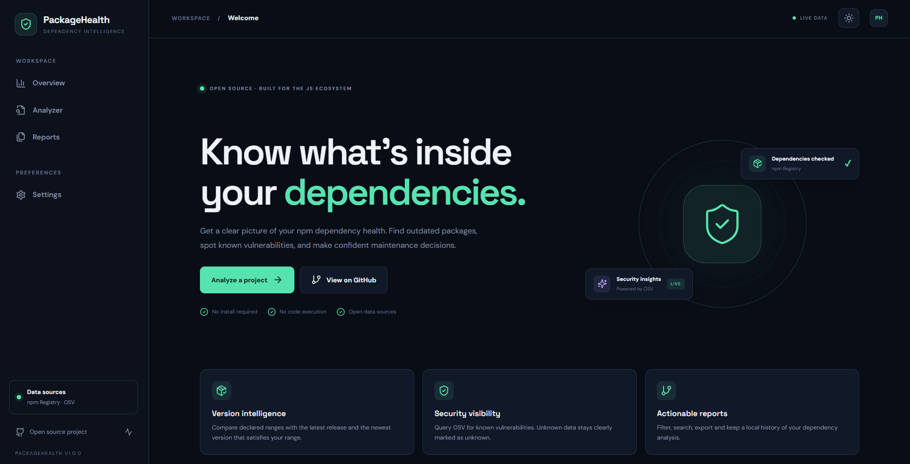
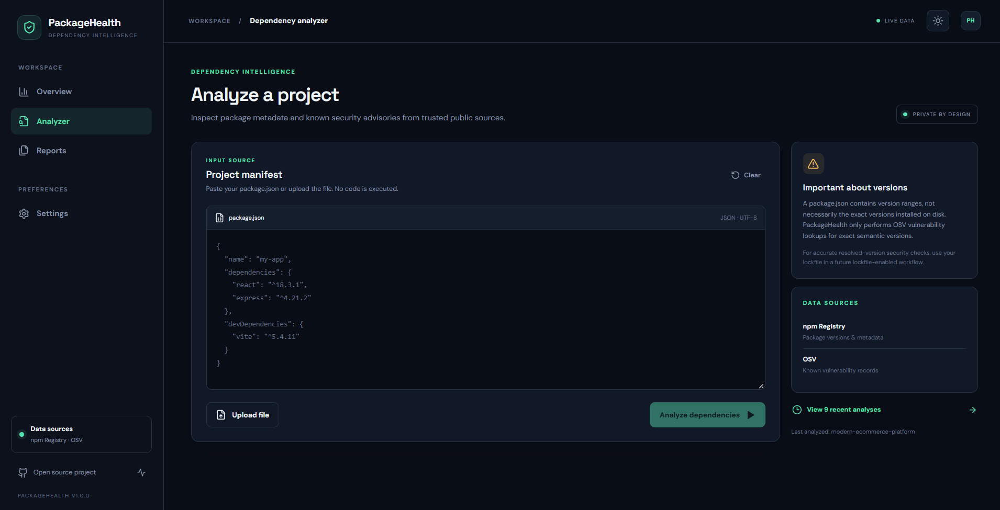
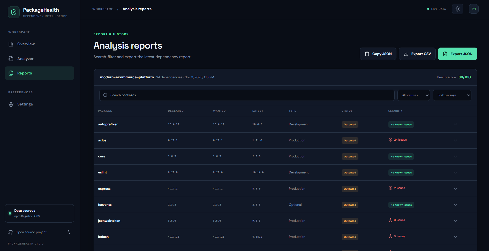
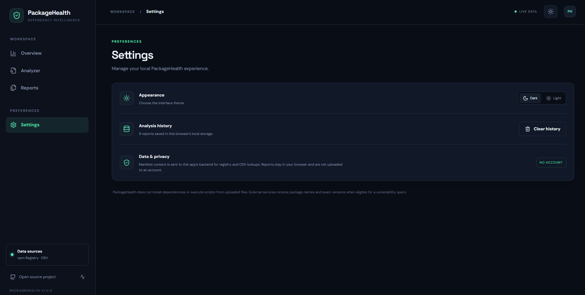

# PackageHealth

**Dependency intelligence for JavaScript projects.** PackageHealth analyzes an npm `package.json` against the public npm Registry and OSV vulnerability database, then turns the results into a searchable, exportable report.

> **Important accuracy note:** a `package.json` contains declared version ranges, not necessarily the versions actually installed. PackageHealth labels these as *declared* versions. OSV lookups are performed only when a dependency value is an exact semantic version (for example `4.17.21`). Ranges such as `^4.17.0` are marked **unknown** for vulnerability status, never safe. Lockfile-based resolution is on the roadmap.

## Features

- Paste a manifest or upload a JSON file (256 KB maximum).
- Validate JSON and dependency maps before analysis; never execute uploaded content or install packages.
- Inspect production, development, optional and peer dependencies.
- Compare declared version specifications with npm's latest release and the newest release satisfying a valid semver range.
- Detect registry deprecation metadata when available.
- Query OSV for known vulnerabilities for exact semantic versions.
- Preserve partial registry results and clearly label unavailable/unknown data.
- Dashboard metrics, a health heuristic, dependency distribution chart and detailed inventory.
- Search, filter, sort, copy JSON, export JSON/CSV and keep the latest 20 reports in browser local storage.
- Responsive UI, dark/light theme, Express API, request limits and input validation.

## Screenshots

### Dashboard


### Analyzer


### Reports


### Settings


## Stack

- Frontend: React 18, Vite 8, JavaScript/JSX, Tailwind CSS, React Router, Lucide React, Chart.js.
- API: Node.js, Express 4, Zod, Axios, semver.
- Data: [npm Registry](https://registry.npmjs.org) and [OSV](https://osv.dev).
- Quality: ESLint, Prettier, Vitest, GitHub Actions.

## Requirements

- Node.js 20 LTS or newer (Node 18.18+ may work with the selected toolchain).
- npm 10+ recommended.
- Internet access from the backend for live npm Registry and OSV requests.

## Quick start (Windows / VS Code)

```powershell
git clone https://github.com/BohraYogesh/PackageHealth.git
cd packagehealth
npm install
Copy-Item .env.example .env
npm run dev
```

Open the Vite URL printed in the terminal (normally `http://localhost:5173`). The API runs at `http://localhost:4000`; Vite proxies `/api` requests to it. `npm run dev` starts both processes together.

If PowerShell's execution policy blocks a command, run the equivalent from Command Prompt or use `copy .env.example .env`.

## Environment variables

| Variable | Default | Description |
| --- | --- | --- |
| `PORT` | `4000` | Express API port |
| `NODE_ENV` | `development` | Runtime environment |
| `CLIENT_ORIGIN` | `http://localhost:5173` | Comma-separated allowed browser origins |
| `API_TIMEOUT_MS` | `12000` | Timeout for each external API request |
| `MAX_PACKAGE_JSON_BYTES` | `262144` | Maximum manifest body size in bytes |
| `RATE_LIMIT_WINDOW_MS` | `60000` | API rate-limit window |
| `RATE_LIMIT_MAX` | `30` | Maximum requests per window and client IP |
| `VITE_API_BASE_URL` | `/api` | Optional frontend API base URL |

No API key is required. Do not put private tokens in `VITE_*` variables; Vite exposes those values to browsers.

## Scripts

| Command | Purpose |
| --- | --- |
| `npm run dev` | Start frontend and backend together |
| `npm run dev:client` | Start Vite only |
| `npm run dev:server` | Start API with Node watch mode |
| `npm run build` | Create the production frontend bundle in `dist/` |
| `npm run preview` | Preview the production frontend bundle |
| `npm start` | Start the API server |
| `npm test` | Run unit and integration tests |
| `npm run test:watch` | Run Vitest in watch mode |
| `npm run lint` | Run ESLint |
| `npm run format` | Format supported project files |
| `npm run format:check` | Check formatting |

## Production deployment

1. Set `NODE_ENV=production`, `CLIENT_ORIGIN` to the deployed frontend origin(s), and tune the rate limit/timeouts for your environment.
2. Run `npm install` and `npm run build` in CI. Commit a generated `package-lock.json` when preparing a tagged release so deployments can use `npm ci`.
3. Deploy `dist/` to a static host (for example, Nginx, Cloudflare Pages or Vercel).
4. Deploy the Express API as a separate Node service and configure `VITE_API_BASE_URL` to its public `/api` base URL at frontend build time. Configure CORS with the exact frontend origin.
5. Terminate TLS at your hosting platform or reverse proxy. Add monitoring and provider-specific abuse protection before exposing a public API.

The Express server intentionally does not serve the Vite bundle; frontend and API can be deployed independently.

## API

### `GET /api/health`

Returns service health and a timestamp.

### `POST /api/analyze`

Request body:

```json
{
  "packageJson": "{\"name\":\"demo\",\"dependencies\":{\"react\":\"^18.3.1\"}}"
}
```

Success response is `{ "data": { ...report } }`. The report includes `project`, `analyzedAt`, `summary`, `dependencies` and `dataQuality`.

Each dependency includes its name, declared version, dependency type, latest and wanted versions (when available), update status, deprecation metadata, npm URL, registry availability and vulnerability status. Vulnerability status values include `scanned`, `unknown` and `unavailable`. `scanned` with a zero count means OSV returned no known advisories for the exact queried version at scan time; it is not a guarantee of safety.

Errors use `{ "error": { "code": "...", "message": "..." } }`. Inputs are limited to 256 KB and 500 dependency entries by default. The API applies a configurable per-IP rate limit.

## Project structure

```text
src/                  React application, pages, reusable UI and client services
  components/         common, layout, dashboard, analyzer, reports and charts
  context/ hooks/     app state and reusable hooks
  pages/              Home, Dashboard, Analyzer, Reports, Settings, NotFound
  services/           centralized API client
  utils/ constants/   report helpers and shared navigation
server/               Express API, validation, controllers and external data services
tests/                unit and integration tests
docs/                 architecture and data semantics
.github/              issue templates, PR template and CI
```

## Data handling and security

- The backend treats uploaded content as untrusted JSON. It validates structure and size and never executes scripts, runs package managers, or extracts archives.
- External requests are made by the backend with timeouts. Registry failures do not fabricate versions; OSV failures remain unknown.
- Package names and exact versions eligible for OSV checks are sent to OSV. npm package metadata is requested by package name from the public npm Registry.
- Reports and history are stored only in the browser's local storage. Clear history in Reports or Settings to remove locally saved report data.
- Do not upload manifests containing private package names if that disclosure is not acceptable to your organization. Private registries and offline mode are not currently supported.

## Known limitations

- A manifest alone cannot reveal the exact installed dependency graph, transitive packages, peer-resolution outcome, or lockfile integrity. The analyzer does not claim to provide those details.
- OSV scanning is limited to exact semantic versions explicitly declared in the manifest. Semver ranges, tags, Git URLs, aliases and workspace references are not treated as installed versions.
- The score is a transparent heuristic for prioritization, not a compliance grade or security certification.
- npm metadata and vulnerability data can change after a report is generated; re-run analysis for a fresh snapshot.

## Contributing

Contributions are welcome. Please read [CONTRIBUTING.md](CONTRIBUTING.md), follow the code style, add tests for behavior changes and open an issue for substantial feature proposals. See [CODE_OF_CONDUCT.md](CODE_OF_CONDUCT.md) and [SECURITY.md](SECURITY.md).

## Roadmap

- Lockfile support (`package-lock.json`, pnpm and Yarn) for resolved direct and transitive versions.
- Better vulnerability severity and affected-range presentation.
- Workspace/monorepo analysis and private registry configuration.
- Historical trend comparisons and scheduled CI reports.
- GitHub Action and machine-readable SARIF output.

## License

MIT. See [LICENSE](LICENSE).
